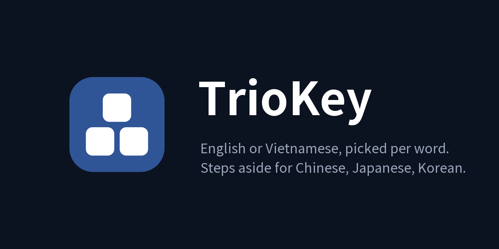

<p align="center"></p>

<p align="center">
  <a href="https://github.com/ved0el/triokey/actions/workflows/ci.yml"></a>
  <a href="https://github.com/ved0el/triokey/releases/latest"></a>
  <a href="https://github.com/ved0el/triokey/releases"></a>
  <a href="LICENSE"></a>
  
</p>

# TrioKey

**English** · [Tiếng Việt](README.vi.md)

A Vietnamese Telex input method for Windows, with an experimental macOS app, for people who type English, Vietnamese and a CJK language (Chinese, Japanese or Korean) every day. There is no English/Vietnamese mode to toggle: each word is decided when you finish it, and TrioKey steps aside by itself while your CJK IME is on. It adds no keyboard layout and changes nothing in your system's input settings.

```text
keys typed          what appears
tieesng vieejt␣     tiếng việt
windows␣            windows
songs␣              sóng         (on a fresh line, the commoner reading wins)
the songs␣          the songs    (after an English word)
this␣⌫              thí          (one Backspace swaps a word the engine was unsure of)
```

TrioKey is early. Telex only (no VNI), and many parts of both apps have not been tested by hand yet; the hand test list and its results are in [docs/HANDS_ON_TEST.md](docs/HANDS_ON_TEST.md).

## How it behaves

**English or Vietnamese.** When a word ends (space, Enter, punctuation), TrioKey compares the keys as typed with their Telex reading, using how common each is as a word and how Vietnamese the current line has been. Code-like text (digits, `_`, mixed case, paths, flags, text after `.` `:` `\`) stays as typed. When the engine was unsure, one Backspace right after the word swaps it to the other reading; a second Backspace deletes as usual.

**CJK IMEs (Windows).** When the Japanese IME is open (hiragana, katakana…), or a Chinese or Korean IME is open in native mode, every key goes straight to the IME. When the IME is closed (direct input), TrioKey types Vietnamese, even under the Japanese layout. So you only use the IME's own on/off. TrioKey does not change the keyboard layout for you. Chinese and Korean have not been tried with a real IME yet.

**Tray icon.** A red `V` means TrioKey types Vietnamese; a blue `E` means keys pass through (switched off, or stepping aside for a CJK IME; the tooltip says which).

### Typed examples

Every line below is checked by the test `readme_examples` in `crates/triokey-engine/tests/engine.rs`. Each line is typed on a fresh line. `␣` is the space bar, `⌫` is Backspace; the space a `␣` leaves at the end is not shown.

```text
keys typed                     what appears
tieesng vieejt␣                tiếng việt
windows terrible␣              windows terrible
DDuowngf␣                      Đường
baajt/taawst␣                  bật/tắt
my_var obj.dir src/main␣       my_var obj.dir src/main       (code is left alone)
server cos␣                    server có          (có is far commoner, even after English)

songs␣                         sóng               (valid both ways: a fresh line leans Vietnamese)
the songs␣                     the songs          (after an English word)
tooi thaasy songs␣             tôi thấy sóng      (after Vietnamese words)

this␣                          this
this␣⌫                         thí                (unsure: one Backspace swaps)
this␣⌫⌫                        th                 (a second Backspace deletes)
off␣⌫                          of
tooi␣⌫                         tôi                (sure: Backspace only deletes the space)
tooi thaasy sets␣              tôi thấy sét       (a common English word after Vietnamese ones...)
tooi thaasy sets␣⌫             tôi thấy sets      (...is always one Backspace away)
There␣                         Thể                (the first word of a line can go wrong...)
There␣⌫                        There              (...one Backspace gives it back)

mixx␣                          mix                (a doubled tone key cancels the mark)
offline passwd Terraform␣      offline passwd Terraform
ko ddc ddaau␣                  ko đc đâu          (common abbreviations with đ compose)
dd/mm/yyyy aa aw␣              dd/mm/yyyy aa aw   (lone dd, aa, aw stay as typed)
toansz␣                        toan               (z removes the tone)
OS naof cungx dduwowcj␣        OS nào cũng được   (ALL CAPS stays unless common Vietnamese)
VIEEJT␣                        VIỆT
chaau As␣                      châu Á             (a one-letter word: Shift on the letter only)
Mac OS␣                        Mac OS             (two capitals are an acronym anywhere)
```

## Install on Windows

1. **Quit every other Vietnamese input method first** (UniKey, EVKey, OpenKey, VKey…). Two running together rewrite each other's text.
2. Download `triokey-X.Y.Z-windows-x64.zip` from the [latest release](https://github.com/ved0el/triokey/releases/latest) and unpack it into a folder of its own. There is no installer.
3. Run `triokey.exe`. No window opens; a red `V` appears in the system tray (maybe behind the `^` arrow).

The exe has no Authenticode signature, so SmartScreen or antivirus software may warn about it. Each release carries `triokey.exe.minisig`, which you can check with [minisign](https://jedisct1.github.io/minisign/) and the key in `crates/triokey/update-pubkey.txt`.

## Install on macOS (experimental)

Each release has `TrioKey-X.Y.Z-macos.dmg` (Apple silicon and Intel, macOS 11 or later; checksum in `SHA256SUMS.txt`).

1. Quit every other Vietnamese input method, and switch to a plain layout such as ABC or U.S.
2. Open the dmg and drag `TrioKey` into `Applications`. Always run it from there.
3. The app is not notarized, so macOS blocks the first open: open it once, click Done, then System Settings > Privacy & Security, scroll down, click Open Anyway, and Open in the next prompt (steps on macOS 15).
4. TrioKey shows a blue `E` in the menu bar and the window `Hướng dẫn cấp quyền` (permission guide). Click `Mở cài đặt Accessibility` (open Accessibility settings) and turn TrioKey on (if it is not listed, click + and choose it in Applications). Within about 2 seconds the menu bar turns to a red `V`; if not, quit TrioKey and open it again.

> [!WARNING]
> **Never turn off or remove TrioKey in the Accessibility list while TrioKey is running.** This can freeze the keyboard and mouse until the Mac restarts. Always quit TrioKey first.

## Usage

The interface is in Vietnamese or English; the main labels are given here in Vietnamese with the English in parentheses.

- **Switch on/off:** left-click the tray icon (Windows), or use the hotkey: Ctrl+Shift (default; press and release alone), Alt+Z (Option+Z on macOS), or none (`Không dùng`). Switching this way is not saved; the on/off box in Settings is.
- **Menu** (right-click the tray icon, or click the menu bar item): `Tiếng Việt` (on/off), `Cài đặt…` (Settings), `Khởi động lại` (Restart), `Thoát` (Quit). On macOS it also has `Hướng dẫn cấp quyền…` (permission guide).
- **Settings** apply at once: on/off, hotkey (`Phím tắt`), `Ngôn ngữ` (Language: `Tiếng Việt` or `English`, switches menus and windows at once), tone placement (`hòa, thúy` or `hoà, thuý`), keep English words automatically (off means plain Telex for every word), step aside for CJK IMEs, start with Windows / at login, admin mode (Windows only), automatic updates with `Kiểm tra bản mới` (check now), and developer mode, which adds buttons to open the config folder and copy debug information (no typed text) for a bug report.
- **Telex:** `aa aw ee oo ow uw dd` → `â ă ê ô ơ ư đ` (`caan` → `cân`, `ddi` → `đi`); `s f r x j` → tone marks; `z` removes the tone. The tone key can come after the vowel or at the end (`tieesng`, `tieengs` → `tiếng`). A lone `w` shows `ư` while you type, and becomes `w` when the word ends (`w␣` → `w`, then `⌫` → `ư`).
- **Remembered swaps.** If you swap a word with one Backspace and then type space, Tab or Enter, TrioKey remembers it. Swapping it back the same way forgets it. In a line that is already Vietnamese, a remembered English reading never replaces the Vietnamese word; it stays one Backspace away. Each step below starts a new line, in this order:

  ```text
  keys typed               what appears
  this␣⌫␣                  thí               (swapped and kept: remembered)
  this␣                    thí
  this␣⌫␣                  this              (swapped back and kept: forgotten)
  this␣                    this
  songs␣⌫␣                 songs             (remembered as English)
  songs␣                   songs
  tooi thaasy songs␣       tôi thấy sóng     (a Vietnamese line keeps the Vietnamese word...)
  tooi thaasy songs␣⌫      tôi thấy songs    (...one Backspace away)
  ```

- **Files** are in `%APPDATA%\triokey` (Windows) or `~/Library/Application Support/triokey` (macOS): `config.txt` (settings), `learned.txt` (remembered words, one `keys<TAB>text` line each; edit it only after quitting TrioKey), and the optional `force_en.txt` / `force_vi.txt` you create yourself: one word per line, written as the keys you type (`this`, not `thí`), always English or always Vietnamese. Restart TrioKey after editing them.

## Known limitations

- **Passwords.** Password fields in browsers and Electron apps cannot be detected, so letters in a password can turn into Vietnamese (`mas!x9` → `má!x9`). Switch TrioKey off with the hotkey while typing a password there. On macOS, TrioKey stops while Secure Input is on (some password fields, Terminal's Secure Keyboard Entry).
- **Two input methods at once** rewrite each other's text. Run only one. Key remappers and remote desktop tools that send ordinary key presses are treated as real keys.
- **Admin windows (Windows).** A normal-privilege TrioKey cannot type into elevated windows. Admin mode in Settings fixes that with one UAC prompt: it copies the exe to `%ProgramFiles%\TrioKey` and adds a logon task. Turn it on from a folder that other programs cannot write to.
- **Suggestion fields** (browser address bar, Excel cells) can end up with different text than expected. Terminals get no special handling.
- **macOS** types only while a plain Latin layout (ABC, U.S.…) is selected; with any other input source, including Japanese in Latin mode, it steps aside, so you switch input sources to get Vietnamese back. There is no admin mode.
- Windows 10 has not been tried.

## Privacy

Like every hook-based input method, TrioKey sees every key you press while it runs. It keeps no typing log: the only typed text it stores is `learned.txt`. The only network use is a check for new versions on GitHub, once a day and when you press `Kiểm tra bản mới`; it sends nothing about you or what you type. Untick automatic updates to stop it. No telemetry.

## Updating

**Windows.** With automatic updates on (default), TrioKey downloads a newer signed version, verifies its signature and replaces its own exe; the new version runs from the next start. The admin-mode copy asks first and updates only when you click the notice.

**macOS.** TrioKey only tells you that a new version is out. Each build needs the permission granted again, so update in this order:

1. Quit TrioKey (menu > `Thoát`).
2. Copy the new `TrioKey` over the one in Applications.
3. In Accessibility, remove TrioKey (−) and add it again (+). Never do this while TrioKey is running.
4. Open TrioKey.

Settings and remembered words are kept.

## Uninstall

**Windows.**

1. If you turned them on, untick admin mode in Settings first, then start with Windows (that box is greyed out while admin mode is on).
2. Quit from the tray menu (`Thoát`).
3. Delete TrioKey's folder, and `%APPDATA%\triokey` if you also want settings and remembered words gone.

If a step fails, the manual commands are in the last section of [docs/HANDS_ON_TEST.md](docs/HANDS_ON_TEST.md).

**macOS.** Untick start at login, quit TrioKey, *then* remove it from Accessibility, and delete the app (and, if you want, `~/Library/Application Support/triokey`).

## Build from source

Only the GNU toolchain (`stable-x86_64-pc-windows-gnu`) builds the Windows app. With [mise](https://mise.jdx.dev), `mise install` in the repository sets it up; with [rustup](https://rustup.rs), install that toolchain.

```sh
git clone https://github.com/ved0el/triokey
cd triokey
cargo build --release -p triokey        # with mise: mise x -- cargo build --release -p triokey
```

The exe is `target\release\triokey.exe`. Tests, the checks CI runs and the macOS build are in [AGENTS.md](AGENTS.md) and [CONTRIBUTING.md](CONTRIBUTING.md).

## How it works

- `triokey-engine`: the Telex composition and per-word decision, pure Rust with no OS calls.
- `triokey-shared`: the config format and other parts both apps share.
- `triokey`: the Windows tray app (keyboard hook and injected text).
- `triokey-mac`: the macOS menu bar app (event tap).

The design, threads, data files, admin mode and updates: [docs/ARCHITECTURE.md](docs/ARCHITECTURE.md).

## Licence

[MIT](LICENSE), by ved0el. Third-party data and credits: [NOTICE.md](NOTICE.md).
