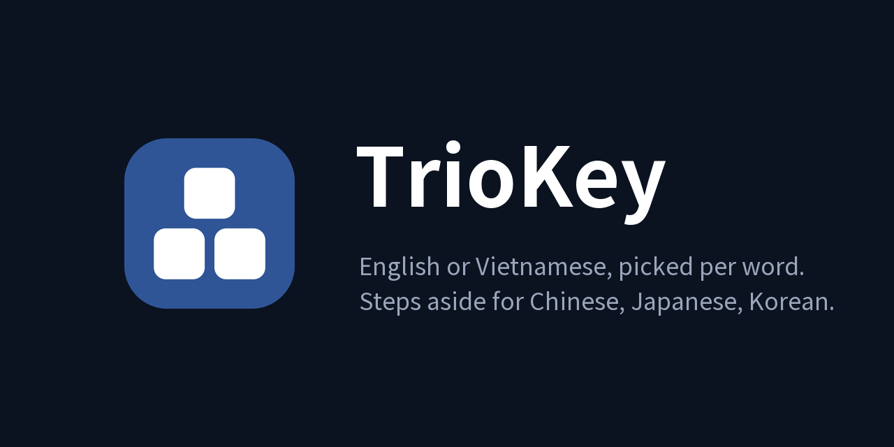

<p align="center"></p>

<p align="center">
  <a href="https://github.com/ved0el/triokey/actions/workflows/ci.yml"></a>
  <a href="https://github.com/ved0el/triokey/releases/latest"></a>
  <a href="https://github.com/ved0el/triokey/releases"></a>
  <a href="LICENSE"></a>
  
</p>

# TrioKey

[English](README.md) · **Tiếng Việt**

Bộ gõ Telex tiếng Việt cho Windows, kèm một ứng dụng macOS còn thử nghiệm, dành cho người ngày nào cũng gõ cả tiếng Anh, tiếng Việt và một thứ tiếng CJK (Trung, Nhật hoặc Hàn). Không có chế độ Anh/Việt phải bật tắt: mỗi từ được quyết định khi bạn gõ xong, và TrioKey tự nhường khi IME CJK của bạn đang bật. Nó không thêm layout bàn phím và không đổi gì trong thiết lập bộ gõ của máy.

```text
phím gõ             chữ hiện ra
tieesng vieejt␣     tiếng việt
windows␣            windows
songs␣              sóng         (đầu dòng mới: cách đọc phổ biến hơn thắng)
the songs␣          the songs    (sau một từ tiếng Anh)
this␣⌫              thí          (một lần Backspace đổi từ mà bộ gõ còn phân vân)
```

TrioKey còn ở giai đoạn đầu. Chỉ có Telex (chưa có VNI), và nhiều phần của cả hai ứng dụng chưa được kiểm bằng tay; danh sách gõ thử và kết quả nằm ở [docs/HANDS_ON_TEST.md](docs/HANDS_ON_TEST.md).

## TrioKey gõ thế nào

**Tiếng Anh hay tiếng Việt.** Khi một từ kết thúc (dấu cách, Enter, dấu câu), TrioKey so dãy phím gõ nguyên với cách đọc Telex của nó, dựa trên độ phổ biến của mỗi bên và việc dòng đang gõ nghiêng về tiếng Việt tới đâu. Chữ trông như mã (có chữ số, `_`, chữ hoa lẫn giữa từ, đường dẫn, tham số, chữ ngay sau `.` `:` `\`) được giữ nguyên. Khi bộ gõ còn phân vân, một lần Backspace ngay sau từ sẽ đổi sang cách đọc kia; Backspace lần hai thì xoá như thường.

**IME CJK (Windows).** Khi IME tiếng Nhật đang mở (hiragana, katakana…), hoặc IME Trung hay Hàn đang mở ở chế độ bản ngữ, mọi phím đi thẳng tới IME. Khi IME đóng (direct input), TrioKey gõ tiếng Việt, kể cả trên layout Nhật. Vậy bạn chỉ cần dùng nút bật/tắt của chính IME. TrioKey không tự đổi layout bàn phím. IME tiếng Trung và tiếng Hàn chưa được thử với IME thật.

**Biểu tượng khay.** Chữ `V` đỏ là TrioKey đang gõ tiếng Việt; chữ `E` xanh dương là phím đi thẳng (đã tắt, hoặc đang nhường IME CJK; di chuột lên để xem lý do).

### Ví dụ gõ

Mọi dòng dưới đây đều được test `readme_examples` trong `crates/triokey-engine/tests/engine.rs` kiểm. Mỗi dòng được gõ ở đầu một dòng mới. `␣` là phím cách, `⌫` là Backspace; dấu cách mà `␣` cuối cùng để lại không được ghi ra.

```text
phím gõ                        chữ hiện ra
tieesng vieejt␣                tiếng việt
windows terrible␣              windows terrible
DDuowngf␣                      Đường
baajt/taawst␣                  bật/tắt
my_var obj.dir src/main␣       my_var obj.dir src/main       (mã được để nguyên)
server cos␣                    server có          (có phổ biến hơn hẳn, kể cả sau tiếng Anh)

songs␣                         sóng               (đúng cả hai cách: dòng mới nghiêng về tiếng Việt)
the songs␣                     the songs          (sau một từ tiếng Anh)
tooi thaasy songs␣             tôi thấy sóng      (sau các từ tiếng Việt)

this␣                          this
this␣⌫                         thí                (còn phân vân: một lần Backspace đổi)
this␣⌫⌫                        th                 (Backspace lần hai thì xoá)
off␣⌫                          of
tooi␣⌫                         tôi                (đã chắc: Backspace chỉ xoá dấu cách)
tooi thaasy sets␣              tôi thấy sét       (từ tiếng Anh thông dụng sau các từ tiếng Việt...)
tooi thaasy sets␣⌫             tôi thấy sets      (...luôn chỉ cách một lần Backspace)
There␣                         Thể                (từ đầu dòng có thể bị đoán sai...)
There␣⌫                        There              (...một lần Backspace là trả lại)

mixx␣                          mix                (phím dấu gõ lặp thì huỷ dấu)
offline passwd Terraform␣      offline passwd Terraform
ko ddc ddaau␣                  ko đc đâu          (chữ viết tắt thông dụng có đ thì được ghép)
dd/mm/yyyy aa aw␣              dd/mm/yyyy aa aw   (dd, aa, aw đứng riêng thì giữ nguyên)
toansz␣                        toan               (z xoá dấu thanh)
OS naof cungx dduwowcj␣        OS nào cũng được   (VIẾT HOA giữ nguyên, trừ từ tiếng Việt thông dụng)
VIEEJT␣                        VIỆT
chaau As␣                      châu Á             (từ một chữ cái: chỉ giữ Shift cho chữ cái)
Mac OS␣                        Mac OS             (hai chữ hoa là từ viết tắt, ở đâu cũng vậy)
```

## Cài trên Windows

1. **Thoát mọi bộ gõ tiếng Việt khác trước** (UniKey, EVKey, OpenKey, VKey…). Hai bộ gõ chạy cùng lúc sẽ sửa chữ của nhau.
2. Tải `triokey-X.Y.Z-windows-x64.zip` từ [bản phát hành mới nhất](https://github.com/ved0el/triokey/releases/latest) rồi giải nén vào một thư mục riêng. Không có bộ cài.
3. Chạy `triokey.exe`. Không có cửa sổ nào hiện ra; ở khay hệ thống xuất hiện chữ `V` đỏ (có thể nằm sau mũi tên `^`).

File exe không có chữ ký Authenticode, nên SmartScreen hoặc phần mềm diệt virus có thể cảnh báo. Mỗi bản phát hành có file `triokey.exe.minisig`, kiểm được bằng [minisign](https://jedisct1.github.io/minisign/) với khoá trong `crates/triokey/update-pubkey.txt`.

## Cài trên macOS (thử nghiệm)

Mỗi bản phát hành có file `TrioKey-X.Y.Z-macos.dmg` (Apple silicon và Intel, macOS 11 trở lên; mã kiểm tra trong `SHA256SUMS.txt`).

1. Thoát mọi bộ gõ tiếng Việt khác, và chuyển sang một bàn phím Latin thường như ABC hoặc U.S.
2. Mở dmg, kéo `TrioKey` vào `Applications`. Luôn chạy từ đó.
3. Ứng dụng chưa được Apple công chứng (notarize), nên macOS chặn lần mở đầu: mở một lần, bấm Xong, rồi vào Cài đặt hệ thống → Quyền riêng tư & Bảo mật, kéo xuống, bấm `Vẫn mở` (Open Anyway), và bấm `Mở` ở hộp thoại tiếp theo (các bước trên macOS 15).
4. TrioKey hiện chữ `E` xanh dương trên thanh menu và cửa sổ `Hướng dẫn cấp quyền`. Bấm `Mở cài đặt Accessibility` rồi bật TrioKey (nếu không thấy trong danh sách thì bấm + và chọn TrioKey trong Applications). Trong khoảng 2 giây, thanh menu đổi sang chữ `V` đỏ; nếu không, hãy thoát TrioKey rồi mở lại.

> [!WARNING]
> **Không bao giờ tắt hoặc xoá TrioKey khỏi danh sách Trợ năng (Accessibility) khi TrioKey đang chạy.** Việc đó có thể làm bàn phím và chuột đứng cho tới khi khởi động lại máy. Luôn thoát TrioKey trước.

## Cách dùng

Giao diện có tiếng Việt và tiếng Anh; dưới đây ghi tên tiếng Việt của các mục chính, kèm tên tiếng Anh trong ngoặc.

- **Bật/tắt:** nhấp trái vào biểu tượng khay (Windows), hoặc dùng phím tắt: Ctrl+Shift (mặc định; bấm rồi nhả, không kèm phím nào khác), Alt+Shift (Option+Shift trên macOS; cũng bấm rồi nhả), Alt+Z (Option+Z trên macOS), hoặc `Không dùng`. Bật/tắt kiểu này không được lưu; ô bật/tắt trong Cài đặt thì được lưu.
- **Menu** (nhấp phải vào biểu tượng khay, hoặc bấm vào mục trên thanh menu): `Tiếng Việt` (bật/tắt), `Cài đặt…` (Settings), `Khởi động lại` (Restart), `Thoát` (Quit). Trên macOS có thêm `Hướng dẫn cấp quyền…`.
- **Cài đặt** có hiệu lực ngay: bật/tắt, `Phím tắt`, `Ngôn ngữ` (Language: `Tiếng Việt` hoặc `English`, đổi menu và cửa sổ ngay lập tức), kiểu bỏ dấu (`hòa, thúy` hoặc `hoà, thuý`), tự giữ nguyên từ tiếng Anh (tắt đi thì mọi từ đều gõ Telex thuần), nhường IME CJK, khởi động cùng Windows / cùng máy, chế độ admin (chỉ Windows), tự động cập nhật kèm nút `Kiểm tra bản mới`, và chế độ phát triển, bật lên thì có thêm nút mở thư mục cấu hình và nút chép thông tin debug (không có chữ đã gõ) để gửi kèm báo lỗi.
- **Telex:** `aa aw ee oo ow uw dd` → `â ă ê ô ơ ư đ` (`caan` → `cân`, `ddi` → `đi`); `s f r x j` → dấu thanh; `z` xoá dấu thanh. Phím dấu gõ ngay sau nguyên âm hay ở cuối từ đều được (`tieesng`, `tieengs` → `tiếng`). Chữ `w` đứng riêng hiện thành `ư` trong lúc gõ, và trở lại `w` khi từ kết thúc (`w␣` → `w`, rồi `⌫` → `ư`).
- **Nhớ lần đổi.** Nếu bạn đổi một từ bằng một lần Backspace rồi gõ dấu cách, Tab hoặc Enter, TrioKey sẽ nhớ. Đổi lại theo cách đó thì nó quên. Ở một dòng đã nghiêng về tiếng Việt, cách đọc tiếng Anh đã nhớ không bao giờ thay từ tiếng Việt; nó chỉ nằm cách một lần Backspace. Mỗi bước dưới đây bắt đầu ở một dòng mới, theo đúng thứ tự:

  ```text
  phím gõ                  chữ hiện ra
  this␣⌫␣                  thí               (đổi rồi giữ: được nhớ)
  this␣                    thí
  this␣⌫␣                  this              (đổi lại rồi giữ: bị quên)
  this␣                    this
  songs␣⌫␣                 songs             (được nhớ là tiếng Anh)
  songs␣                   songs
  tooi thaasy songs␣       tôi thấy sóng     (dòng tiếng Việt giữ từ tiếng Việt...)
  tooi thaasy songs␣⌫      tôi thấy songs    (...chỉ cách một lần Backspace)
  ```

- **File** nằm ở `%APPDATA%\triokey` (Windows) hoặc `~/Library/Application Support/triokey` (macOS): `config.txt` (thiết lập), `learned.txt` (các từ đã nhớ, mỗi từ một dòng `phím<TAB>chữ`; chỉ sửa sau khi đã thoát TrioKey), và hai file tuỳ chọn `force_en.txt` / `force_vi.txt` do bạn tự tạo: mỗi dòng một từ, viết theo phím gõ (`this`, không phải `thí`), luôn là tiếng Anh hoặc luôn là tiếng Việt. Sửa xong hãy khởi động lại TrioKey.

## Giới hạn đã biết

- **Mật khẩu.** Không nhận ra được ô mật khẩu trong trình duyệt và ứng dụng Electron, nên chữ cái trong mật khẩu có thể bị đổi thành tiếng Việt (`mas!x9` → `má!x9`). Hãy tắt TrioKey bằng phím tắt khi gõ mật khẩu ở những ô đó. Trên macOS, TrioKey ngừng khi Secure Input bật (một số ô mật khẩu, `Secure Keyboard Entry` của Terminal).
- **Hai bộ gõ chạy cùng lúc** sẽ sửa chữ của nhau. Chỉ chạy một bộ. Phần mềm đổi phím và remote desktop gửi phím bấm thông thường thì được xử lý như phím thật.
- **Cửa sổ quyền admin (Windows).** TrioKey chạy quyền thường không gõ được vào cửa sổ quyền admin. Chế độ admin trong Cài đặt giải quyết việc này bằng một lần đồng ý UAC: nó chép exe vào `%ProgramFiles%\TrioKey` và thêm một tác vụ chạy lúc đăng nhập. Hãy bật nó từ một thư mục mà chương trình khác không ghi được.
- **Ô tự chèn gợi ý** (thanh địa chỉ trình duyệt, ô Excel) có thể ra chữ khác với mong đợi. Terminal không có xử lý riêng.
- **macOS** chỉ gõ khi đang chọn một bàn phím Latin thường (ABC, U.S.…); với mọi nguồn nhập khác, kể cả tiếng Nhật ở chế độ Latin, nó nhường, nên bạn chuyển nguồn nhập để quay lại gõ tiếng Việt. Không có chế độ admin.
- Windows 10 chưa được thử.

## Riêng tư

Như mọi bộ gõ dùng hook, TrioKey thấy mọi phím bạn bấm khi nó chạy. Nó không ghi nhật ký gõ: chữ đã gõ chỉ được lưu trong `learned.txt`. Kết nối mạng duy nhất là việc kiểm tra bản mới trên GitHub, mỗi ngày một lần và khi bạn bấm `Kiểm tra bản mới`; nó không gửi gì về bạn hay chữ bạn gõ. Bỏ chọn tự động cập nhật để tắt việc này. Không thu thập dữ liệu.

## Cập nhật

**Windows.** Khi bật tự động cập nhật (mặc định), TrioKey tải bản mới có chữ ký, kiểm chữ ký rồi thay file exe của chính nó; bản mới chạy từ lần khởi động sau. Bản chạy ở chế độ admin hỏi trước và chỉ cập nhật khi bạn bấm vào thông báo.

**macOS.** TrioKey chỉ báo là đã có bản mới. Mỗi bản dựng cần cấp quyền lại, nên hãy cập nhật theo đúng thứ tự:

1. Thoát TrioKey (menu → `Thoát`).
2. Chép `TrioKey` mới đè lên bản trong Applications.
3. Trong Trợ năng, xoá TrioKey (−) rồi thêm lại (+). Không bao giờ làm bước này khi TrioKey đang chạy.
4. Mở TrioKey.

Thiết lập và các từ đã nhớ vẫn được giữ.

## Gỡ bỏ

**Windows.**

1. Nếu đã bật, hãy bỏ chọn chế độ admin trong Cài đặt trước, rồi mới bỏ khởi động cùng Windows (ô này bị mờ khi chế độ admin còn bật).
2. Thoát từ menu khay (`Thoát`).
3. Xoá thư mục chứa TrioKey, và `%APPDATA%\triokey` nếu muốn bỏ luôn thiết lập và các từ đã nhớ.

Nếu có bước không được, các lệnh gỡ tay nằm ở mục cuối của [docs/HANDS_ON_TEST.md](docs/HANDS_ON_TEST.md).

**macOS.** Bỏ chọn khởi động cùng máy, thoát TrioKey, *rồi mới* xoá nó khỏi Trợ năng, và xoá ứng dụng (cùng `~/Library/Application Support/triokey` nếu muốn).

## Build từ mã nguồn

Chỉ toolchain GNU (`stable-x86_64-pc-windows-gnu`) build được ứng dụng Windows. Với [mise](https://mise.jdx.dev), chạy `mise install` trong repo là xong; với [rustup](https://rustup.rs), hãy cài toolchain đó.

```sh
git clone https://github.com/ved0el/triokey
cd triokey
cargo build --release -p triokey        # dùng mise: mise x -- cargo build --release -p triokey
```

File exe nằm ở `target\release\triokey.exe`. Cách chạy test, các bước kiểm của CI và cách build bản macOS có trong [AGENTS.md](AGENTS.md) và [CONTRIBUTING.md](CONTRIBUTING.md) (bằng tiếng Anh).

## Cách hoạt động

- `triokey-engine`: ghép Telex và quyết định từng từ, Rust thuần, không gọi hệ điều hành.
- `triokey-shared`: định dạng cấu hình và những phần hai ứng dụng dùng chung.
- `triokey`: ứng dụng khay cho Windows (keyboard hook và gửi chữ).
- `triokey-mac`: ứng dụng trên thanh menu cho macOS (event tap).

Thiết kế, các luồng, file dữ liệu, chế độ admin và cập nhật (bằng tiếng Anh): [docs/ARCHITECTURE.md](docs/ARCHITECTURE.md).

## Giấy phép

[MIT](LICENSE), của ved0el. Dữ liệu bên thứ ba và ghi nhận: [NOTICE.md](NOTICE.md).
